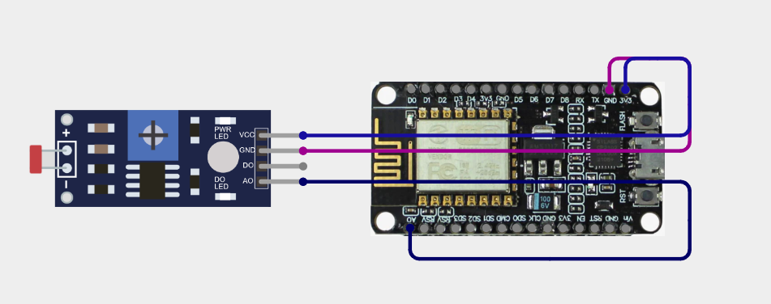
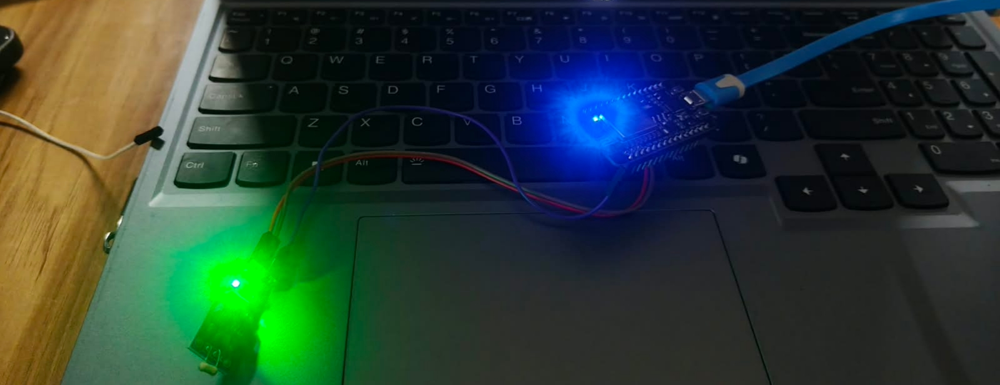
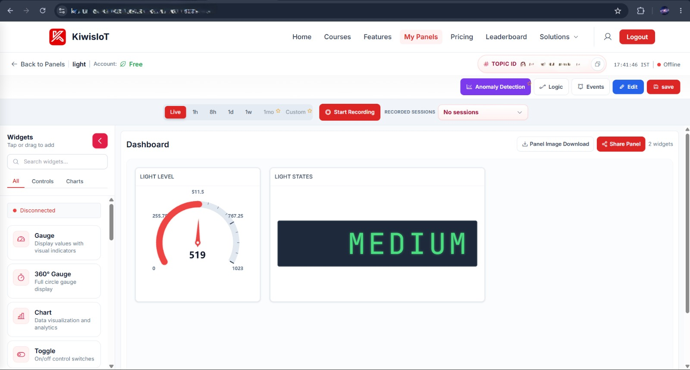

# LDR Based Light Intensity Monitoring using IoT

## 📌 Project Description
This project uses an LDR (Light Dependent Resistor) sensor to measure the intensity of light. The sensor value is collected by a microcontroller (NodeMCU ESP8266) and monitored through an IoT platform using **KiWiS IoT**.

## 🎯 Objective
The main objective of this project is to monitor light intensity in real time using an LDR sensor and display the sensor readings through an IoT platform.

## 🛠️ Components Used
- LDR Sensor (module with VCC, GND, DO, AO pins)
- Microcontroller (NodeMCU ESP8266)
- Resistor
- Jumper Wires
- Breadboard
- Power Supply (USB)
- Wi-Fi Connection

## 💻 Software Used
- Arduino IDE
- KiWiS IoT Platform

## 🔌 Circuit Diagram
| LDR Module | NodeMCU |
|------------|---------|
| VCC        | 3V3     |
| GND        | GND     |
| AO         | A0      |
| DO         | Not connected |

## ⚙️ Working
1. The LDR sensor detects the surrounding light.
2. The LDR produces an analog value based on the light intensity.
3. The microcontroller reads the sensor value.
4. The sensor data is sent to the KiWiS IoT platform.
5. The light intensity value is displayed on the IoT dashboard.
6. The value changes when the surrounding light changes.

## 📊 Output
The IoT dashboard displays the LDR sensor reading in real time.

**Flow:** Light Intensity → LDR Sensor → Microcontroller → Wi-Fi → KiWiS IoT Dashboard

### Hardware Setup (Real-Time)

### KiWiS IoT Dashboard
The dashboard shows a gauge with the light level (0–1023) and a text widget showing the light state (e.g., `MEDIUM`).

## 🚀 Future Enhancement
- Automatic light ON/OFF control
- Mobile notifications
- Data logging and analysis
- Automatic brightness control

## 👨‍💻 Project Type
IoT / Embedded Systems / Sensor Monitoring
